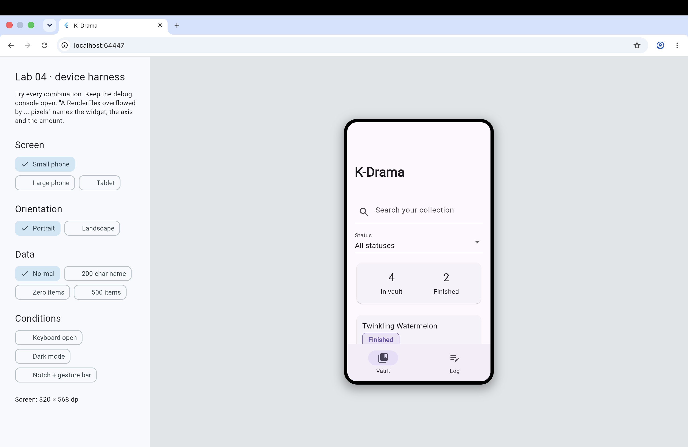
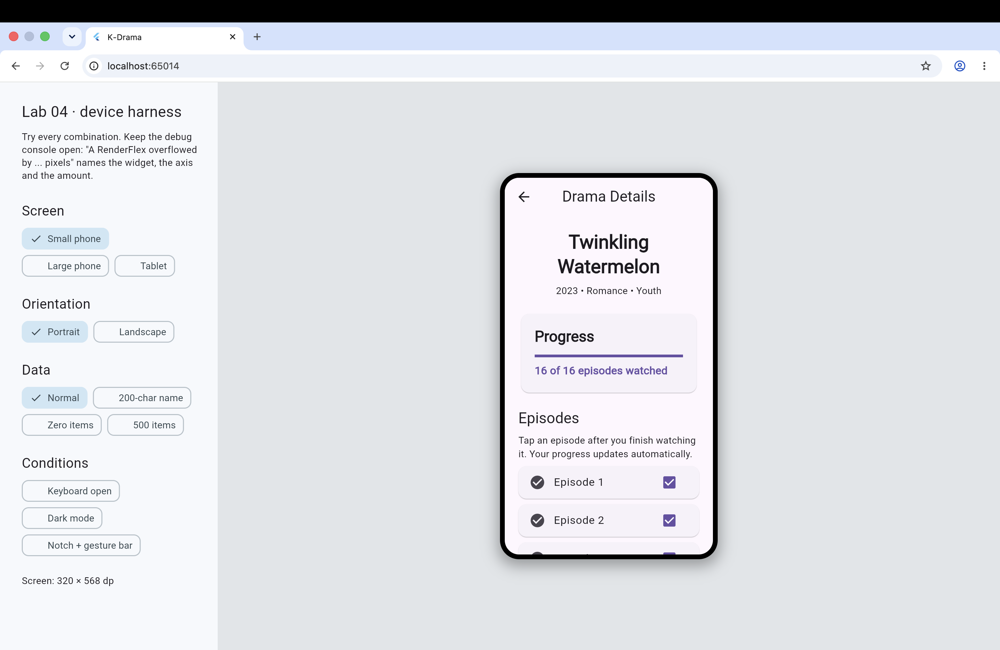
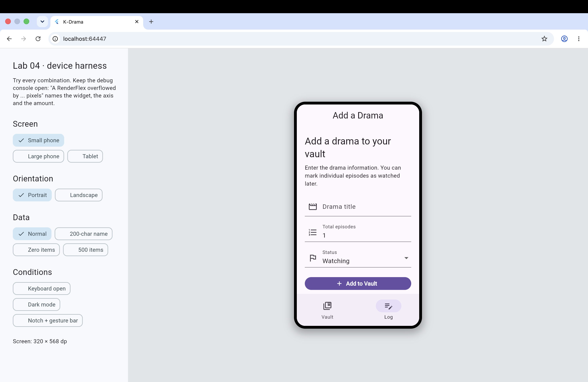

# Explaining your chosen case study, features implemented, and setup instructions.

## Case Study
K-Drama Watchlist & Collection Tracker adalah aplikasi Flutter untuk membantu pengguna mengelola koleksi drama Korea. 
Pengguna dapat melihat daftar drama, mencari drama, memfilter berdasarkan status tontonan, melihat detail drama, dan mencatat episode yang sudah ditonton.
Aplikasi ini menggunakan Track A: The Fandom Vault (Collection & Log Tracker). 

## Features Implemented
- Menampilkan koleksi K-Drama
- Search drama berdasarkan judul
- Filter berdasarkan status: Backlog, Watching, Finished, Dropped
- Melihat detail drama
- Mencatat episode yang sudah ditonton
- Log aktivitas koleksi
- Loading state
- Empty state
- Search-not-found state
- Responsive layout untuk berbagai ukuran layar
- Dark mode
- Penyimpanan data menggunakan local storage

## Setup Instructions
```bash
flutter pub get
flutter run -d chrome
```

## Screenshots

### Home


### Detail


### Log
